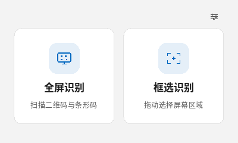
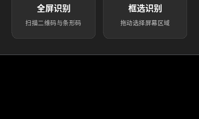
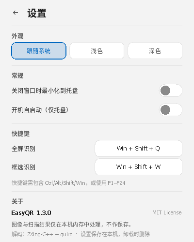
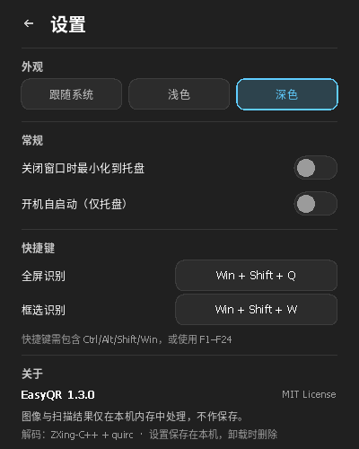
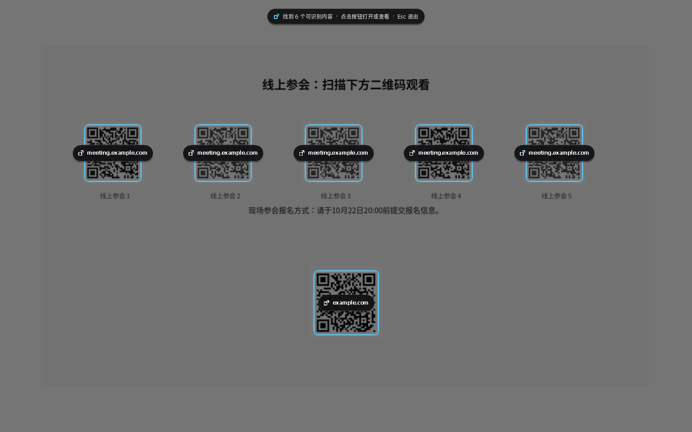
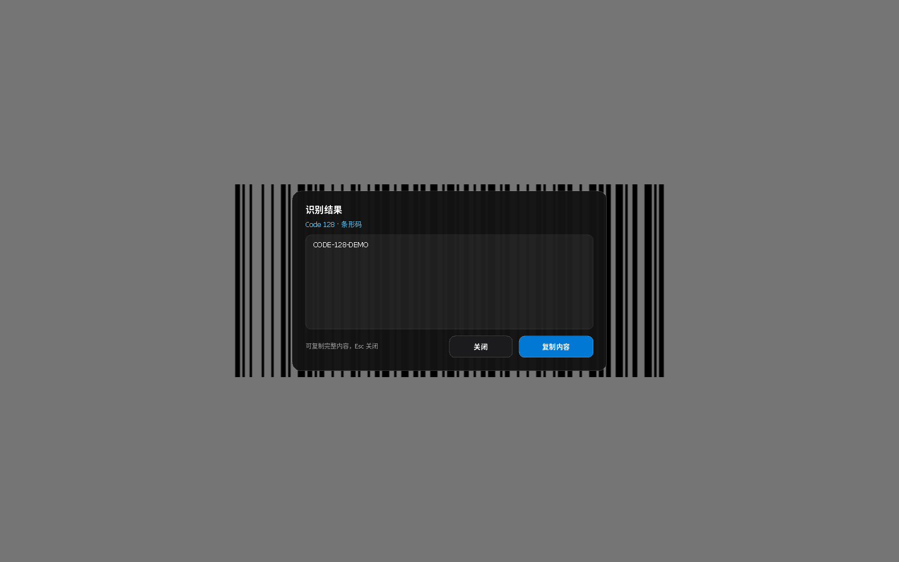

# EasyQR

[](https://github.com/Northodieart/EasyQR/actions/workflows/build.yml)

EasyQR 是一个面向 **Windows 11 x64** 的轻量屏幕二维码 / 条码识别工具。启动后点击「全屏识别」或「框选识别」：识别出的网页直接交给系统默认浏览器；没有网页的内容会进入识别结果面板，可查看并复制。也可以关闭主界面常驻托盘，用全局快捷键随时唤起扫描。

界面为原生 Win32 + Direct2D / DirectWrite + DWM 实现的 Fluent 风格，参考 Windows 11「截图工具」；不依赖 WinUI 3 / .NET 运行时，便携版只是一个约 2 MB 的 EXE。

| 主界面 · 浅色 | 主界面 · 深色 |
| --- | --- |
|  |  |

| 设置 · 浅色 | 设置 · 深色 |
| --- | --- |
|  |  |





## 功能

### 紧凑主界面

- 主窗口只有 **全屏识别**、**框选识别** 两个大图标入口，以及右上角的设置入口，默认尺寸约 400 × 240 DIP，尽量不遮挡屏幕。
- 设置页按需展开，包含外观、常规、快捷键、关于与隐私信息。

### 托盘常驻与开机自启

- 「关闭窗口时最小化到托盘」：开启后点击 × / Alt+F4 会隐藏主界面并在系统托盘继续运行；关闭选项后点击 × 直接退出。设置会保存。
- 托盘菜单提供：打开主界面、全屏识别、框选识别、设置、后台常驻/自启动开关、退出。
- 「开机自启动（仅托盘）」：写入当前用户的 Windows 启动项（`HKCU\Software\Microsoft\Windows\CurrentVersion\Run`）。登录 Windows 后程序直接在托盘启动，不展示主界面，并自动注册全局快捷键。
- 单实例：程序已在托盘时再次启动会唤起现有窗口，不会重复创建托盘图标。
- 从托盘/快捷键发起的扫描结束后会返回托盘，不会打断当前工作。

### 全局快捷键

- 默认：
  - **Win + Shift + Q**：全屏识别
  - **Win + Shift + W**：框选识别
- 在设置 → 快捷键中可以点击按钮后直接按下新的组合键；选择立即生效并持久化。
- 快捷键需包含 Ctrl / Alt / Shift / Win 之一，或使用 F1–F24；如果被其他程序占用会提示并恢复原快捷键。
- 程序运行期间快捷键全局可用，主窗口隐藏到托盘时同样有效。

### 全屏识别

- 主窗口隐藏后捕获整个虚拟桌面（包含所有显示器）。
- 识别到 **1 个可打开网页的码**：不显示加灰选择层，直接在码的中心显示高亮按钮标记，约 0.5 秒后用默认浏览器打开。
- 识别到 **1 个非网页的码**：直接显示识别结果面板。
- 识别到 **多个码**：全屏加灰，在每个码中心显示按钮；网页按钮直接打开浏览器，非网页按钮打开对应结果面板。
- 未识别到任何可读内容时显示提示。

### 框选识别

- 主窗口隐藏，全屏加灰并显示十字准星；拖动框选，界面与操作接近 Windows 11「截图工具」。
- 松开后只识别选区内的码；单码按“网页直接打开 / 其他显示结果面板”处理，多码进入选择层，未命中时显示提示。
- `Esc` 或右键取消，回到发起扫描的位置（主界面或托盘）。

### 识别结果面板

- 显示识别到的码制（如 QR Code、Code 128、Data Matrix 等）和完整文本内容。
- 点击「复制内容」可把完整内容放入 Windows 剪贴板；复制只在用户主动点击时发生。
- 只有内容为 `http://` / `https://` 网页时才会交给默认浏览器；其他内容不会被自动搜索或上传。

### 支持的码制

ZXing-C++ 提供的标准读取器已全部启用，常见包括：

- 二维码：QR Code、Micro QR、rMQR；
- 二维条码：Data Matrix、Aztec、PDF417、MaxiCode；
- 一维码：Code 39、Code 93、Code 128、ITF、Codabar、EAN-8、EAN-13、UPC-A、UPC-E、GS1 DataBar / DataBar Expanded；
- 带 Logo、圆点、彩色等变体的标准二维码同样可识别。

**封闭格式无法离线支持**：抖音圆形扫码、微信小程序码、厂商专有的“三维码”等没有公开解码规范，只有对应平台官方 App/SDK 能解。这不是换一个通用解码库能解决的问题。

## 隐私

- 屏幕截图、灰度图和识别结果全部保留在**内存**中，不写入任何临时图片文件。
- 不保存扫描历史、图像或识别结果；应用本身不发起网络请求。
- 只有在用户触发结果时，才通过系统 `ShellExecute` 交给默认浏览器打开目标网页；只有点击「复制内容」时才写入剪贴板。
- 会持久化的内容只有偏好设置：
  - `HKCU\Software\EasyQR\ThemeMode`（主题）
  - `HKCU\Software\EasyQR\CloseToTray`（关闭窗口时驻留托盘）
  - `HKCU\Software\EasyQR\HotkeyFullscreen` / `HotkeyRegion`（快捷键）
  - 开启开机自启动时，在 `HKCU\Software\Microsoft\Windows\CurrentVersion\Run` 写入一个 `EasyQR` 启动项
- 不保存任何图像、识别文本或扫描记录。安装版卸载时会删除上述设置和自启动项。

## 系统要求

- Windows 11 x64（推荐）。
- Windows 10 x64 亦可运行，但 DWM 圆角 / Mica 标题栏等 Win11 特性会由系统降级。
- 不依赖 .NET、WinUI 运行时、WebView2 或 VC++ Redistributable。

## 下载与安装

构建产物位于 `dist/`：

| 文件 | 说明 |
| --- | --- |
| `EasyQR.exe` | 便携版单文件，双击即用 |
| `EasyQR-1.3.0-x64-portable.zip` | 便携版压缩包（含 EXE 与 LICENSE） |
| `EasyQR-1.3.0-x64-setup.exe` | 安装版 |
| `SHA256SUMS.txt` | 上述文件的 SHA-256 校验和 |

### 安装版

- 安装向导支持选择安装目录；开始菜单快捷方式固定创建，桌面快捷方式可选。
- 在 Windows「设置 → 应用 → 已安装的应用」中可正常卸载。
- 卸载会删除程序文件、开始菜单 / 桌面快捷方式、卸载注册表项、`HKCU\Software\EasyQR` 下的偏好以及开机自启动项。
- 安装包使用标准 NSIS 引导程序（32 位 stub），安装的 `EasyQR.exe` 为纯 64 位。
- 二进制未做代码签名，首次运行时 SmartScreen 可能提示；可核对 `SHA256SUMS.txt` 后选择「更多信息 → 仍要运行」。

### 便携版

把 `EasyQR.exe`（或解压 portable zip）放到任意目录，双击运行即可。不会安装服务或留下临时文件；会按需写入上面列出的偏好和自启动项。不再使用时，关闭开机自启动并删除 `HKCU\Software\EasyQR` 即可。

## 使用提示

- 全屏识别会涵盖所有显示器，按钮直接叠加在各码中心。
- 只有一个可打开网页的码会自动跳转；多个结果时出现可取消的选择层。
- 非网页内容（多数一维码、普通文本等）会进入结果面板；如果一维码中编码的也是 `http/https` 网页，同样会直接打开。
- 深色 / 浅色 / 跟随系统只影响主界面；全屏扫描遮罩为保证可读性始终使用深色。
- 部分受 DRM 保护的窗口、独占全屏 HDR 游戏画面可能无法被 GDI 正确截取。
- 多个二维码指向同一域名时，按钮上的域名标签会相同，请按位置选择。

## 构建

### Linux（仓库使用的交叉编译方式）

依赖：`cmake`、`mingw-w64`（x86_64）、`nsis`、`zip`。ZXing-C++ 与 quirc 源码均已内置在 `vendor/`，无需联网拉取。

```bash
sudo apt install cmake g++-mingw-w64-x86-64 nsis zip
./tests/run_tests.sh     # 原生 URL / 码制解码回归测试
./scripts/build.sh       # 生成 v1.3.0 便携版与安装版
```

### Windows（MSYS2 MinGW-w64）

需要 CMake、MinGW-w64 GCC 与 NSIS。可直接用 CMake 构建（不加载 Linux 的 toolchain 文件），再通过 `-DAPP_EXE=... -DOUTPUT=... -DAPP_ICON=... -DLICENSE_FILE=...` 调用 `makensis`。仓库的 GitHub Actions 也提供了 Linux 交叉构建流程。

## 测试

```bash
./tests/run_tests.sh
```

覆盖内容：

- URL 解析与安全过滤：http/https、裸域名、端口、IPv6、拒绝凭据 / 非网页协议 / 控制字符等。
- 码制 fixtures：单码、6 码同屏、圆点风格带 Logo、小尺寸、反色、无码，以及 Code 128、EAN-13、Data Matrix、Aztec、PDF417、Code 39。
- 已在 Ubuntu 24.04 + Wine 9（Xvfb + Openbox）做过端到端验证：紧凑主界面、主题切换与重启恢复、托盘常驻与隐藏、托盘菜单、默认与自定义全局快捷键、开机自启动隐藏启动、单实例唤起、全屏多码识别、艺术化单码自动打开、条码/文本结果面板与剪贴板复制、框选识别、取消与安装 / 卸载。
- DWM Mica / 圆角标题栏以及 Windows 系统托盘/启动项的最终外观属于 Windows 系统行为，尚未在物理 Windows 11 机器上复测。

## 项目结构

```
src/
  main.cpp       主界面、设置页、托盘、快捷键、主题切换与 Fluent 绘制
  overlay.cpp    截图遮罩、框选、码按钮、结果面板、浏览器/剪贴板动作
  capture.cpp    GDI 虚拟桌面截图（仅内存）
  qr.cpp         ZXing 全格式主解码 + quirc 兜底
  settings.cpp   主题 / 托盘 / 快捷键 / 开机自启动偏好
  url.cpp        网页地址校验与规范化
  render.cpp     调色板、字体、图标、文本绘制
vendor/zxing-cpp/  ZXing-C++ 2.2.1（Apache-2.0）
vendor/quirc/      quirc（ISC）
installer/         NSIS 安装脚本
tests/             URL 与码制回归测试
scripts/           构建脚本
```

## 更新记录

### 1.3.0

- 新增后台常驻：点击关闭可隐藏到托盘，托盘菜单可快速识别、打开设置和退出。
- 新增开机自启动（登录后在托盘隐藏运行），单实例防止重复托盘。
- 新增全局快捷键：默认 **Win + Shift + Q** 全屏识别、**Win + Shift + W** 框选识别，设置页可录入并持久化新组合。
- 设置页扩展为外观、常规、快捷键、关于四个区域。
- 移除结果面板与提示卡下方没有模糊的“假阴影”，改为干净的描边。

### 1.2.0

- 启用 ZXing-C++ 的全部标准码制读取器：二维码、Data Matrix、Aztec、PDF417、MaxiCode 以及常见一维码。
- 新增识别结果面板：网页内容直接打开默认浏览器；条码/文本内容展示完整结果并支持一键复制。
- 多码同屏时，网页按钮直接跳转、其他按钮打开结果面板。
- 主界面描述与版本同步更新到 1.2.0。

### 1.1.1

- 主题选择持久化：用户选择的跟随系统 / 浅色 / 深色会写入当前用户注册表并在下次启动恢复。
- 仅保存这一项主题偏好；图像、灰度数据和识别结果仍然只在内存中处理。
- 安装版卸载时会删除主题偏好键。

### 1.1.0

- 引入 ZXing-C++ 主解码器，quirc 继续作为兜底，修复艺术化 / 圆点风格、小尺寸二维码识别，以及全屏多码漏检问题。
- 主界面缩至约 400 × 240 DIP，只保留两个识别入口；新增设置页，包含浅色 / 深色 / 跟随系统与软件信息。
- 界面、文档、安装包版本同步到 1.1.0。

## 许可

EasyQR 以 MIT License 发布，见 [LICENSE](LICENSE)。

内置的 ZXing-C++ 使用 Apache-2.0，quirc 使用 ISC License，详见 [第三方声明](docs/THIRD_PARTY_NOTICES.md)、[vendor/zxing-cpp/LICENSE](vendor/zxing-cpp/LICENSE) 和 [vendor/quirc/LICENSE](vendor/quirc/LICENSE)。
