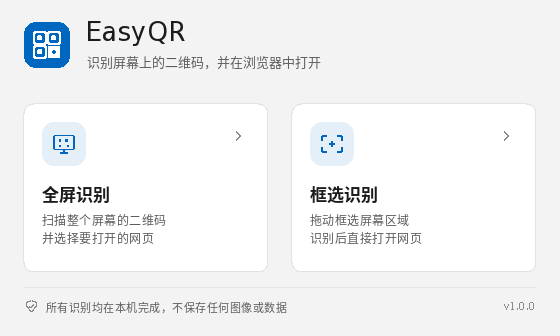
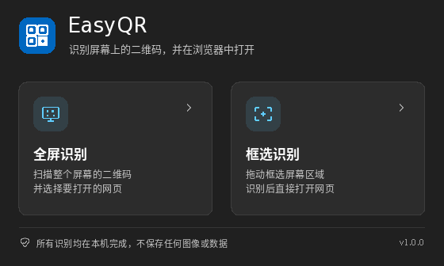

# EasyQR

[](https://github.com/Northodieart/EasyQR/actions/workflows/build.yml)

EasyQR 是一个面向 **Windows 11 x64** 的轻量屏幕二维码识别工具。点击「全屏识别」或「框选识别」，识别结果会用系统默认浏览器打开。

界面为原生 Win32 + Direct2D / DirectWrite + DWM 实现的 Fluent 风格，参考 Windows 11「截图工具」的排版和操作方式；不依赖 WinUI 3 / .NET 运行时，便携版只有一个约 350 KB 的 EXE。

| 浅色 | 深色 |
| --- | --- |
|  |  |

## 功能

### 全屏识别

- 主窗口隐藏后捕获整个虚拟桌面（含所有显示器）。
- 识别到 **1 个**可打开的二维码：不显示加灰选择层，直接在二维码中心显示高亮按钮标记，约 0.5 秒后自动用默认浏览器打开对应网页。
- 识别到 **多个**二维码：全屏加灰，在每个二维码中心显示按钮；点击任意按钮打开对应网页，`Esc` 或右键取消。
- 未识别到二维码，或二维码内容不是网页链接：显示结果提示，不会打开任何地址。

### 框选识别

- 主窗口隐藏，全屏加灰并显示十字准星；按住左键拖动框选，界面与操作接近 Windows 11「截图工具」。
- 松开后只识别选区内的二维码。
- 命中 **1 个**可打开的二维码时直接交给浏览器；命中多个时进入选择界面；未命中时停留在提示层。
- `Esc` 或右键取消，回到主窗口。

### 其他

- 浅色 / 深色模式跟随 Windows 系统设置，运行时切换会即时生效。
- 支持多显示器、Per-Monitor V2 高 DPI。
- 只允许打开 `http://` / `https://` 网页；没有协议头的域名会自动补全为 `https://`；其他协议或非网页内容会被阻止并提示。
- 二维码解码内置 [quirc](https://github.com/dlbeer/quirc)（ISC 许可），无外部 DLL。
- 单文件便携版，无运行时依赖，不写注册表。

## 隐私

- 屏幕截图和灰度识别数据全部保留在**内存**中，不写入任何临时图片文件。
- 不保存配置、日志、扫描历史、剪贴板内容或任何应用数据；软件关闭后不保留任何扫描相关内容。
- 应用本身不发起网络请求；只有用户触发结果时，才通过系统 `ShellExecute` 交给默认浏览器打开目标网页。
- 应用不写注册表，仅读取系统主题设置。安装版的安装/卸载信息由安装器按 Windows 规范写入并在卸载时删除。

## 系统要求

- Windows 11 x64（推荐）。
- Windows 10 x64 亦可运行，但界面圆角 / Mica 标题栏等 Win11 特性会由系统自动降级。
- 不依赖 .NET、WinUI 运行时、WebView2 或 VC++ Redistributable。

## 下载与安装

构建产物位于 `dist/`：

| 文件 | 说明 |
| --- | --- |
| `EasyQR.exe` | 便携版单文件，双击即用 |
| `EasyQR-1.0.0-x64-portable.zip` | 便携版压缩包（含 EXE 与 LICENSE） |
| `EasyQR-1.0.0-x64-setup.exe` | 安装版 |
| `SHA256SUMS.txt` | 上述文件的 SHA-256 校验和 |

### 安装版

- 安装向导支持选择任意安装目录（包含空格的路径也可通过目录选择器选择）。
- 创建开始菜单快捷方式；桌面快捷方式可选。
- 在 Windows「设置 → 应用 → 已安装的应用」中可正常卸载。
- 卸载会删除程序文件、开始菜单 / 桌面快捷方式、卸载注册表项以及可能存在的 EasyQR 应用数据目录；应用运行期间本身不产生数据。
- 安装包使用标准 NSIS 引导程序（32 位 stub），安装的主程序 `EasyQR.exe` 为纯 64 位。
- 当前二进制**未做代码签名**，首次运行时 Windows SmartScreen 可能提示；可核对 `SHA256SUMS.txt` 后选择「更多信息 → 仍要运行」。

### 便携版

把 `EasyQR.exe`（或解压 portable zip）放到任意目录，双击运行即可。不会安装服务、写注册表或留下临时文件。

## 使用提示

- 全屏识别会涵盖所有显示器；多码按钮直接叠加在各二维码中心。
- 全屏识别只有一个可打开二维码时会自动跳转，这是设计行为；多个结果时才会出现可取消的选择层。
- 部分受 DRM 保护的窗口、独占全屏 HDR 游戏画面可能无法被 GDI 正确截取，此时会识别失败。
- 二维码必须完整显示且足够清晰；当前支持标准 QR Code，不支持 Micro QR、条形码或屏幕外的反光/透视极端场景。
- 多个二维码指向同一域名时，按钮上的域名标签会相同，请按二维码位置选择。

## 构建

### Linux（正是本仓库使用的交叉编译方式）

依赖：`cmake`、`mingw-w64`（x86_64）、`nsis`、`zip`。

```bash
sudo apt install cmake g++-mingw-w64-x86-64 nsis zip
./tests/run_tests.sh     # 原生 URL / QR 解码测试
./scripts/build.sh       # 生成便携版与安装版到 dist/
```

`scripts/build.sh` 会使用 `cmake/toolchain-mingw64.cmake` 交叉编译出 x86-64 PE，并用 NSIS 生成安装包、打包 portable zip 与 `SHA256SUMS.txt`。

### Windows（MSYS2 MinGW-w64）

需要 CMake、MinGW-w64 GCC 与 NSIS。可直接使用 CMake 构建（不加载 Linux 的 toolchain 文件），然后在 `installer/EasyQR.nsi` 中通过 `-DAPP_EXE=... -DOUTPUT=... -DAPP_ICON=... -DLICENSE_FILE=...` 调用 `makensis`。仓库的 GitHub Actions 也提供了 Linux 交叉构建流程。

## 测试

```bash
./tests/run_tests.sh
```

覆盖内容：

- URL 解析与安全过滤：http/https、裸域名、端口、IPv6、拒绝凭据 / 非网页协议 / 控制字符等。
- QR 解码 fixtures：单码、多码、反色二维码、无二维码。
- 已在 Ubuntu 24.04 + Wine 9（Xvfb + Openbox）做过端到端 UI 验证：主界面、浅 / 深色、全屏多码选择、单码自动打开、框选、取消、无结果提示、安装 / 卸载。
- DWM Mica / 圆角标题栏属于 Windows 11 合成器行为，尚未在物理 Windows 11 机器上复测。

## 项目结构

```
src/
  main.cpp       主窗口、主题、Fluent UI 绘制
  overlay.cpp    截图遮罩、框选、二维码按钮、自动打开
  capture.cpp    GDI 虚拟桌面截图（仅内存）
  qr.cpp         quirc 解码封装（含反色兜底）
  url.cpp        网页地址校验与规范化
  render.cpp     调色板、字体、图标、文本绘制
vendor/quirc/    ISC 许可的二维码解码库
installer/       NSIS 安装脚本
tests/           URL 与 QR 解码测试
scripts/         构建脚本
```

## 许可

EasyQR 以 MIT License 发布，见 [LICENSE](LICENSE)。内置的 quirc 使用 ISC License，见 [第三方声明](docs/THIRD_PARTY_NOTICES.md) 与 [vendor/quirc/LICENSE](vendor/quirc/LICENSE)。
